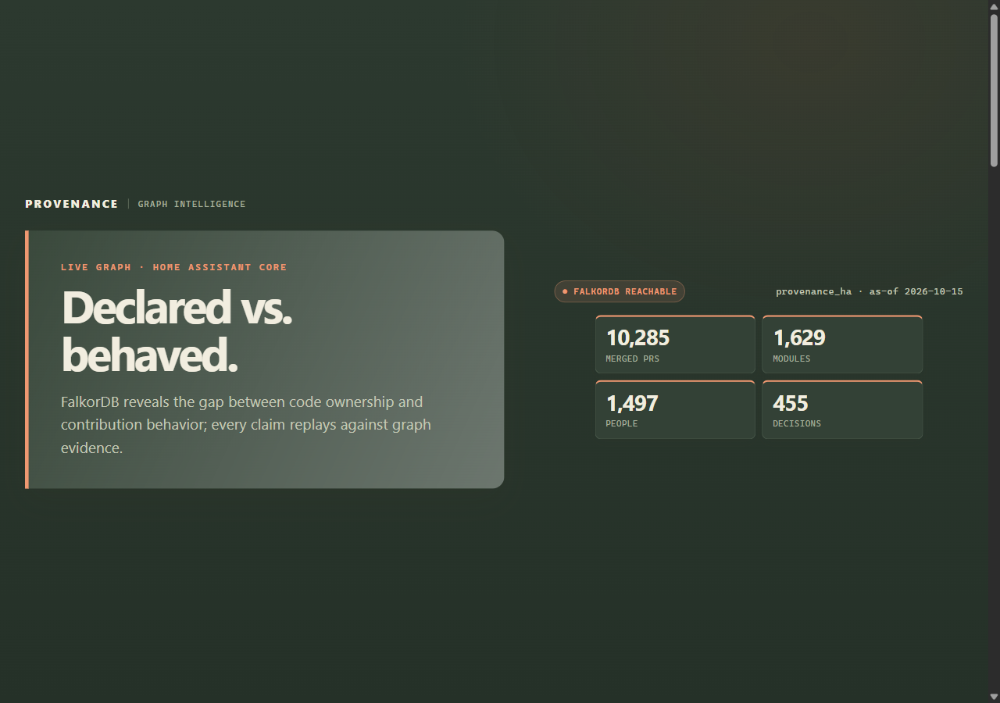
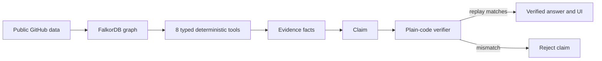
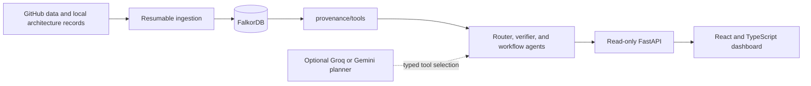
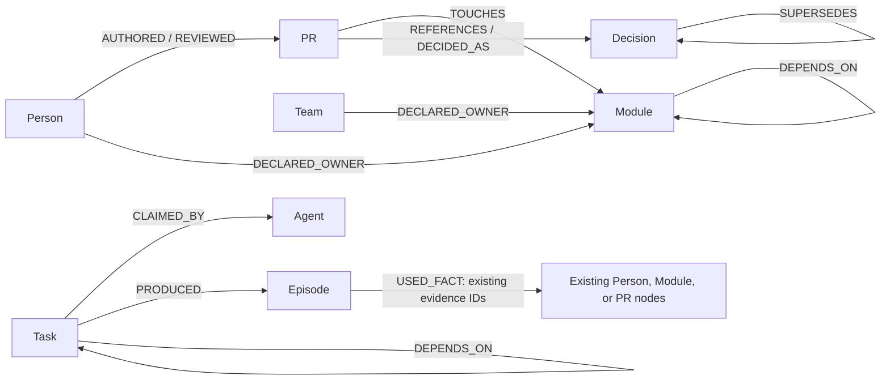
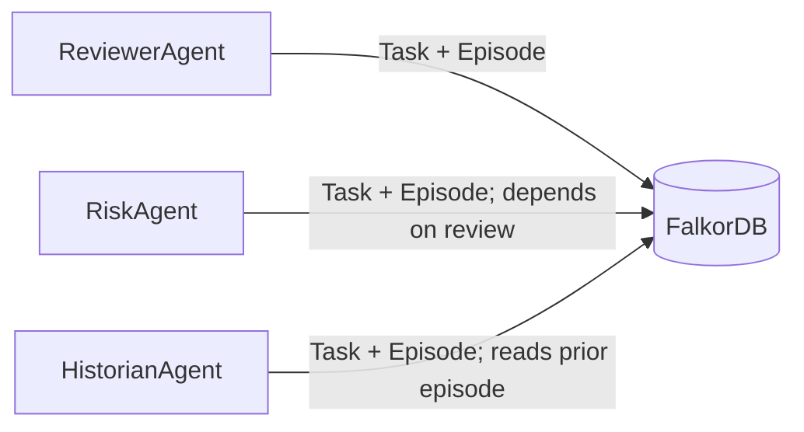

# Provenance

**Declared ownership meets observed contribution—every answer replays against graph evidence.**



## The problem

On the original held-out evaluation, declared-owner B1 scored 0.144 hit@3 across 2,683 primary-reviewer targets. In the Home Assistant graph snapshot (2026-10-15), if `epenet` stops reviewing, 21 modules lose expert coverage and 751 distinct dependent modules are affected. The graph contains 10,285 PRs, 1,629 modules, 1,497 people, and 455 decisions.

## How it works



## Architecture



## Graph schema



Persisted labels include `Person`, `Team`, `Module`, `PR`, `Decision`, `Task`, `Episode`, and synthetic `Agent`. Episodes keep query IDs, parameters, extractors, and original evidence IDs. See [docs/graph_model.md](docs/graph_model.md) for properties and edge semantics.

## What makes answers trustworthy

Tools return registered queries, parameters, and node/edge evidence. A plain-code verifier replays queries against FalkorDB; claims pass only when extracted values reproduce exactly. The UI marks verified claims and truncated subgraphs.

```text
Question: What happens if epenet leaves?
Claim: 751 distinct dependent modules are affected across uncovered modules.
Status: VERIFIED
Replay queries: activity.rows@1, maintainer.dependents.depth2@1
Evidence returned: 150 nodes, 258 edges
Evidence available: 6,519 nodes, 17,402 edges (subgraph truncated)
```

## Evidence, not vibes

Pooled per-target as-of results on unseen Folds B+C (`n=2,812`):

| Method | hit@3 | MRR |
| --- | ---: | ---: |
| B1 | 0.169 | 0.153 |
| B2 | 0.440 | 0.434 |
| B3 | 0.470 | 0.449 |
| RAG | 0.569 | 0.488 |
| G1 | 0.555 | 0.481 |
| G3 | 0.600 | 0.500 |

G3 exceeds text-retrieval RAG by 0.031 hit@3; the paired 95% confidence interval is +0.012 to +0.049. This is an aggregate ranking result, not universal superiority: on the cold-start slice, RAG reaches 0.633 hit@3 versus G3 at 0.593, and pooled hit@1 is higher for RAG (0.343) and G1 (0.356) than G3 (0.323). Ownership and dependency edges are current snapshots without validity intervals.

## Multi-agent coordination



The agents wrap deterministic tools and store memory in graph state. Separate tenant graph names prevent Task/Episode crossover; the concurrency demo reports outcomes for 20 parallel graph writes.

## Quick start

Requirements: Windows PowerShell, Python 3.11+, Node.js 20+, Docker Desktop, and a GitHub token for public-data ingestion. Rebuilding fetches a fresh rolling data window.

1. Clone and install the backend:

   ```powershell
   git clone https://github.com/srishtipandey1/provenance.git
   Set-Location provenance
   py -3.11 -m venv .venv
   .\.venv\Scripts\python.exe -m pip install -r requirements.txt
   Copy-Item .env.example .env
   notepad .env
   ```

   Add your `GITHUB_TOKEN` to `.env`; keep that file private and untracked.

2. Start FalkorDB, fetch the public source data, and build the graph:

   ```powershell
   docker compose up -d falkordb
   .\.venv\Scripts\python.exe scripts\gate0.py
   .\.venv\Scripts\python.exe scripts\fetch_prs.py --days 180
   .\.venv\Scripts\python.exe scripts\load_graph.py
   ```

3. In terminal one, start the API:

   ```powershell
   .\scripts\serve.ps1
   ```

4. In terminal two, install and start the dashboard:

   ```powershell
   Set-Location frontend
   npm ci
   npm run dev
   ```

   Open `http://localhost:5173`. From the repository root, run the demos with:

   ```powershell
   .\.venv\Scripts\python.exe scripts\coordination_demo.py
   .\.venv\Scripts\python.exe scripts\tenant_demo.py
   .\.venv\Scripts\python.exe scripts\concurrency_demo.py
   ```

   API and demo details are in [docs/api.md](docs/api.md).

## Project structure

| Path | Purpose |
| --- | --- |
| `provenance/ingest/` | Cache and graph loading |
| `provenance/tools/` | Typed tools, query registry, evidence replay |
| `provenance/agents/` | Router, verifier, optional LLM, coordination |
| `provenance/api/` | Read-only FastAPI |
| `frontend/` | React dashboard and tests |
| `results/` | Evaluation and risk artifacts |
| `scripts/` | Ingestion and demo commands |
| `tests/` | Graph, tool, verifier, coordination tests |

## What's next

- Add validity intervals to ownership and dependency edges for historical as-of evaluation.
- Fuse G3 with retrieval to improve cold-start ranking without erasing top-1 tradeoffs.
- Add repository adapters with testable identity and path mapping.
- Ingest organization charts to connect public history with internal teams.
- Expand verifier replay coverage for multi-hop claims and explicitly expose evidence truncation.

[srishtipandey1/provenance](https://github.com/srishtipandey1/provenance)